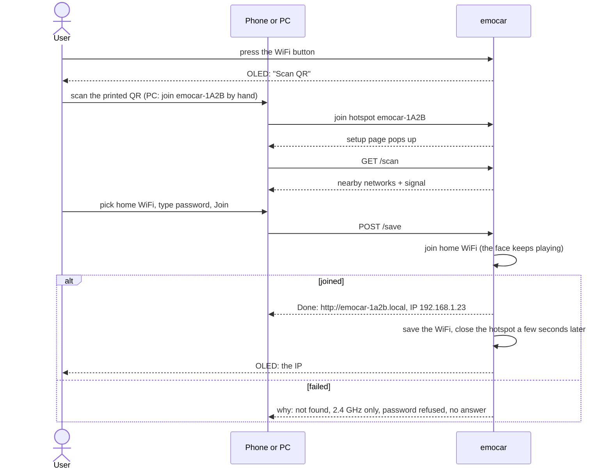
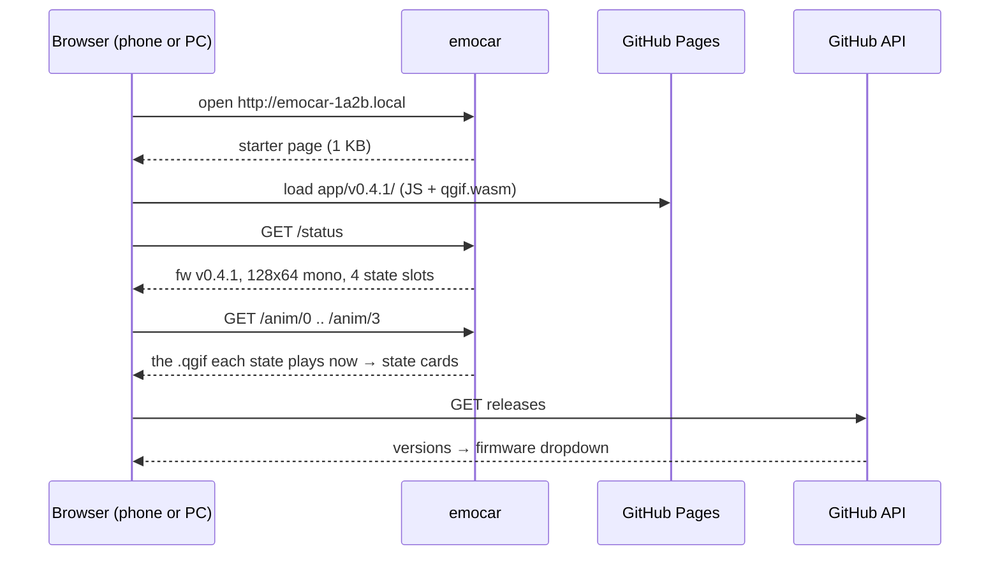
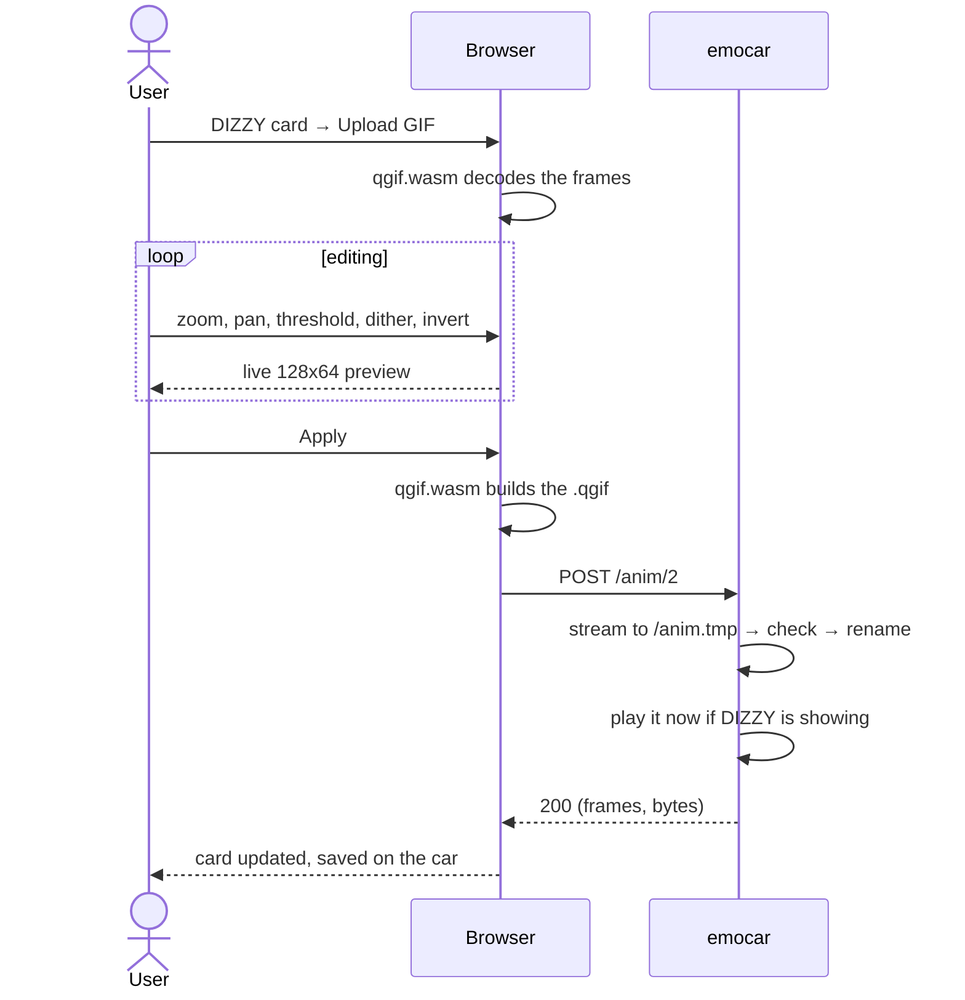
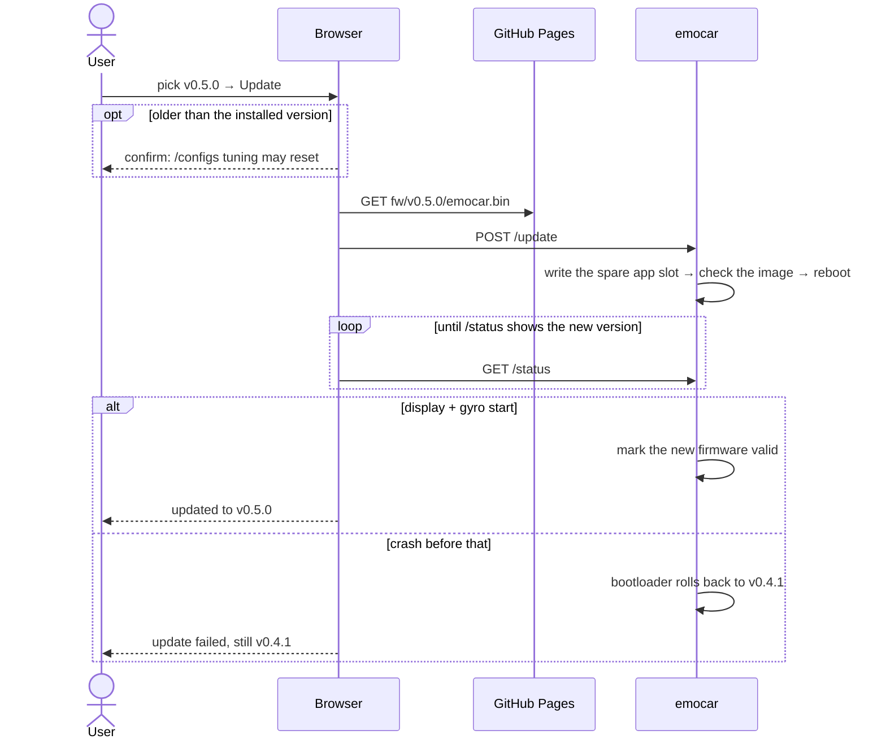
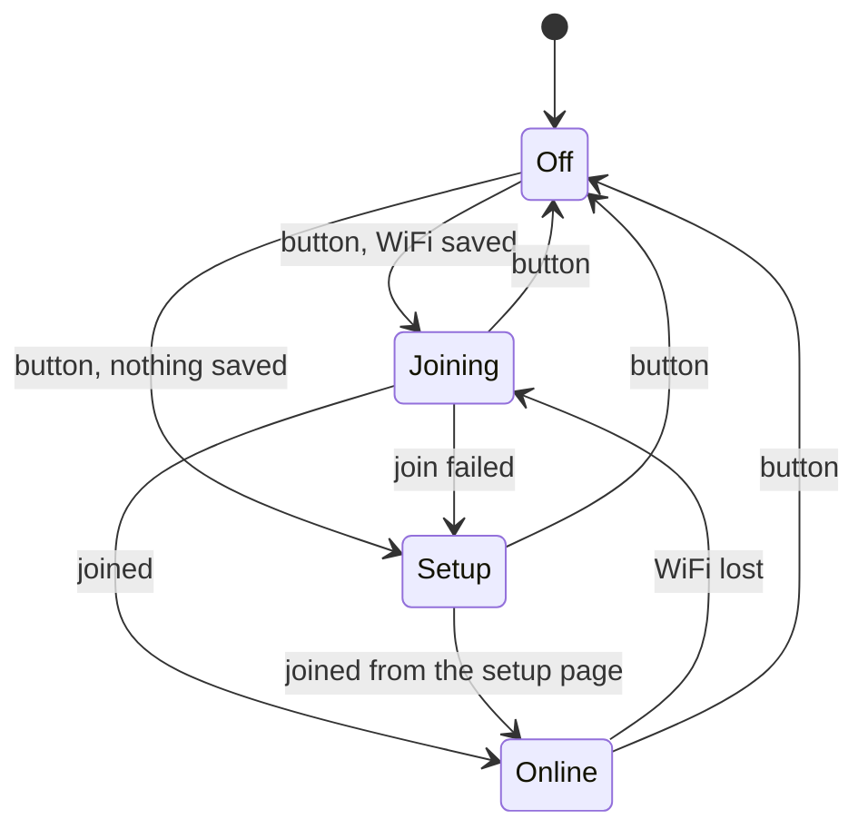
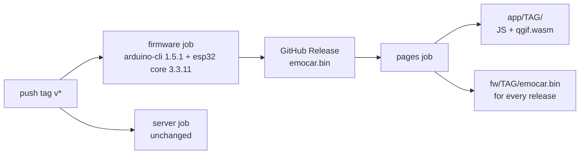

# Plans

One track: **WiFi + a web app on GitHub Pages**, so cars with no USB port can be set up,
given new GIFs and updated from a phone or a PC. Planned 2026-10-11; nothing built yet.

Earlier plans (state machine v2, the GIF upload tool options) are done or dropped — the
current firmware is what users want. They live in git history (`26690b1:PLANS.md`).

## Why

- Production cars hide the USB port. Users are friends, not strangers.
- WiFi was removed on 2026-09-20 because the AP cost ~80–100 mA it never slept off — half
  the battery. It comes back **only while a button turns it on** (button design: later).
- The Go server in `server/` stays for USB development; nothing here replaces it.

## Devices

Any phone or PC with a browser, on the same home WiFi as the car.

| | iPhone / iPad | Android phone | PC (Windows / macOS / Linux) |
|---|---|---|---|
| First setup | Camera scans the QR → setup page pops up | Camera scans the QR → setup page pops up | No camera: join `emocar-1A2B` with the password printed under the QR → setup page pops up (or open `192.168.4.1`) |
| Open the app | `http://emocar-1a2b.local` | `.local` depends on the phone → use the IP | `.local` works on macOS, Windows 10+, most Linux desktops; IP otherwise |
| GIFs, firmware | Safari, Chrome | Chrome, any browser | Any browser |

The car's IP is shown on the setup page's "Done" screen and on the OLED while WiFi is on.

## Workflow

### 1. First setup — once per home WiFi

### 2. Open the app

### 3. Change a state's GIF

### 4. Update firmware

## Design

### WiFi on the car

Core libraries only: `WiFi`, `WebServer`, `DNSServer`, `ESPmDNS`, `Preferences`.

| State | Radio | Serves |
|---|---|---|
| Off | off (battery) | nothing |
| Setup | hotspot `emocar-1A2B` + DNS that answers everything with the car | setup page (`/`, `/scan`, `/save`, `/status`) |
| Joining / Online | home WiFi, `emocar-1a2b.local` | car API (below) |

- **Per-unit names from the chip ID**, one printed QR per car:
  `WIFI:T:WPA;S:emocar-1A2B;P:<password>;;` — two cars on one network never collide.
- **The face never stops:** joining is a step in `loop()`, and nothing reboots (a reboot
  recalibrates the gyro).
- **Status on the OLED** ("Scan QR", "Joining…", the IP). The C3's LED is GPIO8 = SDA and its
  BOOT button is GPIO9 = SCL, so neither is usable.
- **Forget the saved WiFi** with the new button.
- No password on the car's API on the home WiFi — accepted for friends.

### Flash layout — `partitions.csv`, frozen once shipped

The C3 has 4 MB. OTA needs two app slots, so each firmware must fit one slot. Measured on
the C3 with core 3.3.11:

| Build | Bytes | of a 1.25 MB slot |
|---|---|---|
| empty sketch | 295,650 | 22% |
| emocar today | 496,644 | 37% |
| WiFi setup alone (hotspot, setup page, mDNS, saved WiFi) | 1,064,807 | 81% |
| WiFi setup + HTTPS + HTTPUpdate | 1,207,505 | 92% |
| emocar + WiFi (estimated) | ≈ 1.2–1.4 MB | doesn't fit safely |

The default layout is too tight and the built-in options give GIFs 128 KB or nothing. Ours:

| Partition | Offset | Size | Holds |
|---|---|---|---|
| nvs | 0x9000 | 20 KB | saved WiFi |
| otadata | 0xe000 | 8 KB | which app slot boots |
| app0 | 0x10000 | 1.5 MB | firmware |
| app1 | 0x190000 | 1.5 MB | firmware (update target) |
| spiffs | 0x310000 | 896 KB | LittleFS: GIFs, `cfg.bin` |
| coredump | 0x3F0000 | 64 KB | |

- Flashed **once over USB** before the port is hidden. It wipes LittleFS — GIFs get pushed again.
- **Never changed after the first car ships**: OTA can't rewrite the partition table.

### Car API — core `WebServer`, same origin as the app

| Route | Does |
|---|---|
| `GET /` | starter page: loads the app built from **this firmware's tag** from Pages |
| `GET /status` | fw version, API version, display w/h/format, slots `[{frames, bytes}]` |
| `GET /anim/<n>` | raw `.qgif` of slot n |
| `POST /anim/<n>` | upload, streamed to `/anim.tmp` → `qgifCheckFile` → rename → `animReload` |
| `POST /update` | firmware upload, streamed into the spare slot via `Update` → reboot |

Uploads reuse the validate-to-temp-then-rename path `cmd.cpp` already has; `WebServer`'s
upload handler hands over chunks, so nothing big sits in RAM. `/configs` and `/dashboard`
can move to WiFi later — not part of this plan.

### Web app on GitHub Pages

**Why a starter page on the car.** A page served from `https://…github.io` can't call
`http://emocar-1a2b.local` in Safari or Firefox (mixed content), and Chrome 142+ allows it
only behind a Local Network Access prompt. A plain-HTTP page *loading* HTTPS scripts is
always allowed, and Pages sends `access-control-allow-origin: *` (checked). So the car serves
1 KB, the app comes from Pages, and the app is same-origin with the car: no CORS, no prompt,
every browser on every device.

Consequence: a non-secure context — no `crypto.subtle`. Not needed: the ESP32 image carries
its own checksum and `Update` rejects a bad one.

- **New folder `web/`**, plain HTML/JS, look taken from `server/web/index.html`.
- **Converter = `server/qgif.go` compiled to WebAssembly** with standard Go. Go's `image/gif`
  decodes, so no JS GIF library; output is byte-identical to the PC server and
  `qgif_test.go` guards both. ~2–3 MB, cached after the first load.
- **No GIF storage anywhere.** No library on Pages (`emoji_lib/` excluded). The car keeps
  only the converted `.qgif`; editing a state again = upload the GIF again.
- **One app per release:** CI deploys `app/<tag>/` and the starter page loads its own
  version, so firmware and app always speak the same API — also after going back to an
  older firmware. A UI change ships with a tag.

### Firmware updates — the browser carries the file

The car never downloads anything itself: no HTTPS on the car (~140 KB saved), and no root
certificates that can go stale — a car without USB that can't validate GitHub's
certificate could never update again.

GitHub release assets send **no CORS header** (checked: the 302 and the final 200), so a
browser can't fetch them. CI mirrors every release's `emocar.bin` to Pages under
`fw/<tag>/emocar.bin`. The list comes from the Releases API (CORS `*`, 60 req/h per IP).

**Dropdown:**

| Entry | Label | |
|---|---|---|
| v0.5.0 | latest | |
| v0.4.1 | installed | Update disabled |
| v0.4.0 | | asks to confirm: older, /configs tuning may reset |
| v0.3.0-rc1 | test build | a GitHub pre-release |

- Newest first; only releases with `emocar.bin` attached (v0.2.0, server-only, is hidden).
- **Hard floor in the app:** never list anything older than the first WiFi release — a
  USB-only firmware on a car with no USB would end its updates for good.
- **Rollback:** core 3.3.11 is built with `CONFIG_BOOTLOADER_APP_ROLLBACK_ENABLE`. The sketch
  defines `verifyRollbackLater()` → `true` and marks the new app valid only after the
  display and gyro start.

### CI — GitHub Actions on tag `v*`

- **Separate jobs**, so the known macOS failure of the server build can't block the others.
- **firmware:** arduino-cli downloaded as a pinned archive (no extra action), core pinned —
  both the versions used on the desk. `~/.arduino15` cached with `actions/cache`. The tag
  is stamped into the firmware version.
- **pages:** rebuilds the whole site each time — every release's `app/<tag>/` and
  `emocar.bin` are collected again (server side, no CORS issue).

## Build order

1. [ ] `partitions.csv` + firmware version string; flash by USB; confirm GIFs push again
2. [ ] WiFi setup (no button yet — on at boot while developing)
3. [ ] Car API: `/status`, `/anim/<n>`, `POST /anim/<n>`, starter page
4. [ ] `qgif.go` → WASM; `web/` app: state cards, upload, editor, apply
5. [ ] `POST /update` + rollback check; firmware dropdown
6. [ ] CI jobs + Pages (needs the repo public)
7. [ ] The button: on/off, forget, maybe auto-off
8. [ ] Test on iPhone, Android and a PC; range test with the C3 antenna on the car; close up

## Open

- **Button** — GPIO, short press / long press, auto-off after N minutes. Talk later.
- **Repo public** — required for free Pages; user will make it public.
- **`.local` names** — not every device resolves them (some Android phones); the IP on
  the OLED and the setup page is the fallback.
- **Range** — C3 Super Mini antennas are often weak; measure on the car.
